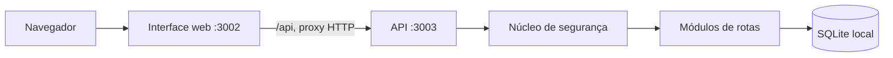

# Arquitetura e isolamento de falhas

## Interface e API

O servidor `apps/web/server.js` usa apenas módulos nativos de Node.js. Ele serve
exclusivamente `apps/web/public`, com validação de caminhos e sem expor o banco.
Também encaminha `/api` ao destino configurado. O navegador usa sempre a mesma
origem; o proxy mantém o Host público, cookies de sessão e respostas de erro.
Requisições de escrita com Origin diferente são rejeitadas na interface e API.
Cabeçalhos hop-by-hop e encaminhamentos fornecidos pelo cliente são removidos.
O proxy informa à API o endereço real do cliente em `X-Forwarded-For`; a API só
aceita esse cabeçalho de proxies confiáveis (por padrão, a própria máquina).
Assim o limite de tentativas de login conta por cliente, não pelo proxy.
Fora da própria máquina o transporte é sempre HTTPS. A regra está em
`packages/http/transport-policy.js` e é conferida pelos dois servidores antes de
abrirem a porta: a interface recusa iniciar em endereço não local sem TLS
próprio ou sem um proxy HTTPS declarado (`SUPREMA_BEHIND_HTTPS_PROXY`, que exige
`SUPREMA_WEB_TRUSTED_PROXIES`); a API, que não usa TLS, recusa endereço não local
sem `SUPREMA_API_PRIVATE_NETWORK`. A API faz essa conferência antes de abrir o
banco. Com TLS ou proxy declarado, as respostas levam o cabeçalho HSTS e o cookie
de sessão é marcado como `Secure`.
O proxy encerra uma operação após 30 segundos sem resposta completa. Um timeout
não permite concluir se o servidor confirmou uma escrita antes da desconexão:
atualize o estado antes de repetir uma operação. Não há repetição automática.

Os arquivos de interface foram separados por funcionalidade mantendo a ordem
de scripts e estilos. O comportamento visual e as fórmulas existentes foram
mantidos. O cliente HTTP comum trata respostas e falhas de conexão. Um aviso
independente consulta a saúde a cada 15 segundos, sem recarregar a página.

## Módulos da API

| Módulo | Rotas sob sua responsabilidade |
| --- | --- |
| importacao-alunos | `/api/admin/student-import/*` |
| planilhas | `/api/assessment/:id/import`, `/import/confirm`, `/export` |
| administracao | demais `/api/admin/*` |
| avaliacoes | demais `/api/assessment/*` e `/api/assessments` |
| evolucao | `/api/evolution` |
| alunos | `/api/student/*` |
| osce | `/api/osce/*` |
| avaliacao-docente | `/api/teacher-eval/*` |
| comprovantes | `/api/receipts/*` |
| articulacao | `/api/articulation/*` |

O OSCE é o primeiro módulo construído sobre o núcleo de formulários
(`core/forms.js`, tabelas da migração 005): formulário, perguntas, envios e
respostas brutas. O núcleo não conhece o OSCE; cada módulo decide quem monta,
quem responde e quem lê, e chama o núcleo dentro da própria transação. As
respostas não aceitam alteração nem exclusão no banco, e um envio só pode ser
anulado, permanecendo guardado. A Avaliação Docente usa o mesmo núcleo. O SQL
do módulo fica em `modules/osce/store.js` e o do núcleo em `core/forms.js`,
separados das regras das rotas.

A Articulação Interdisciplinar **não** usa o núcleo de formulários. As tabelas
do núcleo só aceitam respostas Sim, Não e Não se aplica, com comentário; a
Articulação precisa de nota de 0 a 10, de Sim, Não e Parcialmente e de escolha
em três listas (período, tutor e estação). Aceitar esses tipos exigiria
reconstruir tabelas que já guardam respostas do OSCE e da Avaliação Docente. O
módulo tem as próprias tabelas (`articulation_*`, migração 010) e todo o seu
SQL em `modules/articulacao/store.js`. As respostas são identificadas e não
aceitam alteração nem exclusão no banco.

O cálculo que vem da instituição fica isolado em `core/calculo/`, um arquivo
por módulo, sem banco e sem rotas: recebe respostas e devolve números.
`core/calculo/articulacao.js` reproduz as fórmulas da planilha de resultado
final da Articulação (média, maior e menor nota; percentual de cada resposta
sobre o total de respondentes) e é usado pelas rotas de resultado e pela
exportação, que grava as mesmas fórmulas nas células. Não há número único de
desempenho por tutor: a instituição não usa, e `performance.available` é
sempre falso. `core/calculo/osce.js` reproduz as fórmulas da planilha do OSCE
(acertos, redução pela metade sem o item de postura, nota de 0 a 1 por estação
e as médias do "Resultado Final") e é usado do mesmo modo pelas rotas e pela
exportação do OSCE. `tests/integration/calculo_articulacao.test.js` e
`tests/integration/calculo_osce.test.js` avaliam as fórmulas das planilhas e
comparam com esses arquivos.

Os comprovantes ficam em `core/receipts.js` (migração 009), porque servem a
mais de um módulo. Quem registra a ação do aluno chama `Receipts.issue` dentro
da própria transação: ou a ação e o comprovante existem, ou nenhum dos dois. O
registro guarda quem, o quê e quando, nunca o conteúdo, e não aceita alteração
nem exclusão. O código tem 80 bits aleatórios. O PDF é montado a partir do
registro, sem biblioteca externa, e a verificação é uma consulta ao servidor
pelo código: o arquivo não é fonte de verdade.

A Avaliação Docente usa o **caminho anônimo** do núcleo (migração 007). A
participação ("o aluno X já respondeu sobre Y") e as respostas ficam em tabelas
sem nenhuma coluna em comum além do que foi avaliado. As três tabelas são
`WITHOUT ROWID`, portanto não guardam a ordem de inserção; a resposta tem
identificador aleatório e só a data; nenhuma linha aceita alteração ou
exclusão; a auditoria registra que um aluno respondeu em uma avaliação, sem o
professor e sem o conteúdo. Os resultados só existem depois do encerramento,
que é definitivo, e acima de um mínimo de respostas, para que uma consulta não
revele a resposta de uma pessoa.

Limite desse anonimato: uma cópia isolada do banco não liga resposta a aluno,
mas quem comparar duas cópias de momentos diferentes (dois backups, por
exemplo) vê quais participações e quais respostas surgiram no intervalo. Com um
único respondente nesse intervalo a ligação fica possível. Isso exige acesso aos
arquivos de backup e não é eliminado pelo esquema.

Na interface, um módulo registra-se nos pontos de extensão e desenha no
contêiner que recebe, sem substituir funções de `app.js`:
`window.SupremaModules.add(perfil, item)` para a tela de perfil (CSTI,
Coordenação, Núcleo, conta operacional), para o menu do Administrador e para a
entrada no menu do aluno, e `window.SupremaViews[nome]` para os itens do menu
do professor. Um perfil pode receber itens de vários módulos. Os utilitários
de tela (`SupremaUI.toast`, `guard`, `panel`, `table`) e os estilos comuns
(`styles/modulos.css`, classe `.mod-root`) têm uma implementação só.

Os complementos das telas do professor e do aluno (`indicadores/analytics.js`
e `academico/academico.js`) seguem a mesma regra desde a versão 12: registram-se
em `window.SupremaHooks` e o `app.js` os chama depois de desenhar a tela base
(`teacher.results`, `teacher.individual`, `student.result`) ou antes de
recarregar os dados do aluno (`student.boot`). Nenhum arquivo substitui função
de outro, e a falta de um complemento não impede a tela base. O roteiro para
acrescentar uma funcionalidade está em `COMO_CRIAR_UM_MODULO.md`.

O manifesto em `apps/api/src/modules/index.js` contém carregadores adiados.
Cada instalador recebe um Router isolado e o mesmo contexto de banco e segurança.
Só depois do registro completo o Router é publicado. Se `require` ou instalação
falhar, o Router é descartado e uma resposta 503 fica restrita às rotas daquele
módulo. Os módulos mais específicos são registrados primeiro para uma falha na
importação não impedir os cadastros ou as avaliações.

O indicador por módulo em `/api/health` descreve o **carregamento na inicialização**;
não é uma monitoração permanente de todas as operações. Erros nas requisições
seguem para o tratador de erro central. Não se descarrega um módulo nem se abre
permissão de acesso como recuperação. Autenticação e banco são essenciais: se
falharem ao iniciar, a API não fica disponível. O servidor web permanece separado.

## Autorização

`core/roles.js` lista os perfis que uma conta pode ter. O que cada perfil pode
fazer está na tabela `role_permissions` e é verificado por `security.can()` a
cada requisição. Um perfil sem linhas nessa tabela entra e troca a própria
senha, e nada mais.

| Permissão | Perfil | Rotas |
| --- | --- | --- |
| `admin.manage` | ADMIN | `/api/admin/*` |
| `assessment.own` | PROFESSOR | `/api/assessments`, `/api/assessment/*` |
| `results.own` | ALUNO | `/api/student/*` |
| `evolution.all` | ADMIN | `/api/evolution`, todas as avaliações |
| `evolution.own` | PROFESSOR | `/api/evolution`, somente as próprias |
| `osce.manage`, `osce.results` | NUCLEO_AVALIACAO | montagem e resultados do OSCE |
| `osce.respond` | OPERACIONAL | respostas do OSCE no ambulatório |
| `teacher_eval.manage` | CSTI | montagem da Avaliação Docente |
| `teacher_eval.answer` | ALUNO | responder a Avaliação Docente |
| `teacher_eval.own` / `teacher_eval.all` | PROFESSOR / COORDENACAO | resultados próprios / de todos |
| `receipts.own` | ALUNO | os próprios comprovantes |
| `receipts.verify` | ADMIN, CSTI | verificar e pesquisar comprovantes |
| `articulation.manage` | CSTI | montagem, etapas, respostas e exportação da Articulação |
| `articulation.answer` | ALUNO | responder a Articulação |
| `articulation.results` | COORDENACAO | resultados identificados, depois de liberados |
| `articulation.own` | PROFESSOR | o próprio quadro de tutor, sem nomes |

Um módulo novo concede permissões ao seu perfil em uma migração própria; não
se compara o nome do perfil dentro das rotas. A permissão diz que tipo de
operação o perfil faz; a posse do registro continua verificada em cada rota
(por exemplo, o professor só alcança as avaliações de que é titular).

As sessões ficam na tabela `sessions`, identificadas pelo SHA-256 do token do
cookie. Os contadores de tentativas de login ficam em memória.

## Limites

O isolamento de processos protege a disponibilidade dos servidores web e API.
O isolamento de Routers protege contra falhas de carregamento e erros tratáveis
de requisição em funcionalidades. Os módulos não são serviços independentes:
compartilham memória, banco e event loop. Um loop infinito, `process.exit`, falta
de memória ou falha nativa pode derrubar a API inteira. A interface permanece
acessível, mas não consulta nem salva dados sem uma API funcional.

Componentes comuns da interface (`shared`, HTML base e a aplicação principal)
também são dependências compartilhadas. A separação em pastas não elimina essa
dependência. Alterações nesse núcleo exigem os testes integrados.

## Banco e compatibilidade

`data/avaliacao_suprema.db` continua no mesmo local. `SUPREMA_DATA_DIR` permite
usar outro diretório. A cópia local usada na validação mantém os bytes do arquivo recebido; o banco
não é versionado no GitHub.
Testes usam diretórios temporários, e a validação da migração usa uma cópia do
banco. A inicialização original continua fazendo migrações aditivas e sincroniza
vínculos, podendo criar A3 e linhas de rascunho ausentes. Notas, publicações e
senhas anteriores são verificadas. Reinícios não recriam contas padrão.

A criação idempotente das tabelas originais continua em `core/database.js` e
roda a cada início, porque bancos recebidos antes não têm versão confiável.
Toda mudança nova é uma migração numerada em `core/migrations/`, registrada em
`schema_migrations`, aplicada uma vez e na mesma transação da inicialização.
Antes de migrar um banco com dados, uma cópia é gravada em `data/pre-migracao`.
Não há migração de retorno: desfazer significa restaurar essa cópia.

O backup (`scripts/backup.js`) e a restauração (`scripts/restore.js`) são
comandos avulsos, fora do processo da API; o agendamento fica no sistema
operacional. Cada backup é verificado, recebe um registro com data, hash e
versão do banco, e os mais antigos são removidos pela retenção. A restauração
confere esse registro, recusa backup de versão mais nova que o código e guarda o
banco substituído em `data/pre-restauracao`. O roteiro está em `BACKUP.md`.

O valor máximo dos instrumentos fora da prova (SAI, estações do OSCE, trabalho,
outros) fica em `assessment_instrument_config` (migração 004). Ele não participa
de `calcScore`: serve para validar a publicação e para calcular percentuais. O
registro de cada publicação guarda os máximos vigentes, e só inclui essa parte
quando algum máximo foi declarado, para que publicações anteriores continuem
comparando iguais. Sem máximo declarado o sistema não calcula percentual.

O que o aluno recebe sobre a turma passa por `core/privacy.js`: abaixo do
mínimo de resultados publicados, a API não envia nenhum número derivado das
notas dos colegas.

O esquema completo está em `docs/modelagem/esquema_atual.sql`. O arquivo é
gerado por `scripts/schema-doc.js` a partir de um banco novo, depois de todas
as migrações, e um teste falha quando ele fica desatualizado.

## Formato e legibilidade do código

Todo o JavaScript e o CSS seguem o formato do Prettier (`.prettierrc.json`),
conferido pelo `npm test`. A reformatação da base compactada foi provada
equivalente: `scripts/format-equivalence.js` compara a árvore de sintaxe e os
comentários de cada arquivo antes e depois, e `tests/browser/css_equivalence.py`
compara as regras de estilo como o navegador as interpreta. Os dois servem
para qualquer mudança futura que deva ser só de formatação.

A prévia dos totais na planilha do professor (`recalcLocal`, no navegador)
repete a conta do servidor (`calcScore`), que é a única que vale.
`tests/integration/calculo_tela.test.js` compara as duas.

Restam linhas longas em alguns arquivos da interface: são trechos de HTML
dentro de texto, que o formatador não divide.

O histórico de notas (`score_changes`, `publication_snapshots`) só recebe
inserções; gatilhos do banco recusam alteração e exclusão. `published_scores`
continua sendo a versão atual que o aluno vê.

`server.js` continua exportando `createApplication` e `start` da API para clientes
que importavam esse arquivo. `node server.js` e `npm start` iniciam o conjunto.
O `start` exportado inicia somente a API, agora na porta 3003 por padrão.
`PORT` configura o acesso web; `API_PORT` configura a API. Os scripts operacionais
antigos foram arquivados porque vários apontavam para outro banco ou contrato.
