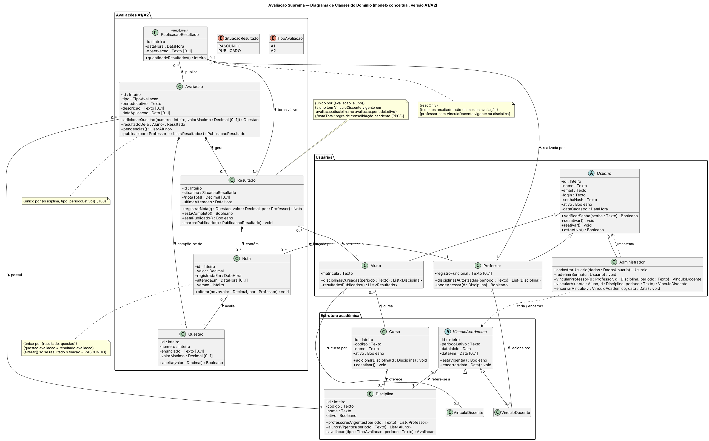
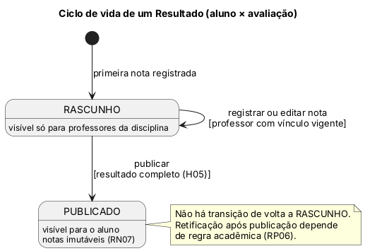

# Modelagem UML — Avaliação Suprema

Documentação fornecida em 10 de novembro de 2026: casos de uso, classes do
domínio, ciclo de vida dos resultados, proposta de evolução e modelo físico.

O [documento completo em PDF](Avaliacao_Suprema_Modelagem_UML.pdf) reúne os
requisitos, regras de negócio, hipóteses e pendências da modelagem.

## O banco de dados que o sistema realmente cria

O esquema em uso está em [esquema_atual.sql](esquema_atual.sql). Esse arquivo é
**gerado**: `npm run docs:schema` abre um banco novo e vazio, aplica a criação
inicial e todas as migrações e escreve as tabelas, os índices, os gatilhos e as
permissões de cada perfil. Um teste do `npm test` falha quando uma migração
muda o banco e o arquivo não é gerado de novo. Não edite o arquivo à mão.

O [modelo físico recebido](modelo_fisico.sql) é uma **proposta histórica** de
10 de novembro de 2026 e **não corresponde** ao banco: descreve 9 tabelas com
nomes em português, e o sistema usa 41 tabelas com outros nomes. Ele fica
guardado como referência, com o conteúdo original, junto com os diagramas.

## Organização

```text
docs/modelagem/
  README.md                              índice e orientação de uso
  esquema_atual.sql                       esquema real, gerado do banco
  Avaliacao_Suprema_Modelagem_UML.pdf      documento completo recebido
  modelo_fisico.sql                       proposta histórica de modelo físico
  imgs/                                  imagens dos sete diagramas
  uml/                                   fontes PlantUML editáveis (.puml)
```

## Diagramas

| Diagrama | Imagem | Fonte editável |
| --- | --- | --- |
| Casos de uso: visão geral | [PNG](imgs/01_uc_geral.png) | [PlantUML](uml/01_uc_geral.puml) |
| Casos de uso: administrador | [PNG](imgs/02_uc_administrador.png) | [PlantUML](uml/02_uc_administrador.puml) |
| Casos de uso: professor | [PNG](imgs/03_uc_professor.png) | [PlantUML](uml/03_uc_professor.puml) |
| Casos de uso: aluno | [PNG](imgs/04_uc_aluno.png) | [PlantUML](uml/04_uc_aluno.puml) |
| Classes do domínio | [PNG](imgs/05_classes.png) | [PlantUML](uml/05_classes.puml) |
| Estados do resultado | [PNG](imgs/06_estados_resultado.png) | [PlantUML](uml/06_estados_resultado.puml) |
| Evolução e novas modalidades | [PNG](imgs/07_evolucao.png) | [PlantUML](uml/07_evolucao.puml) |

### Classes do domínio



### Ciclo de vida do resultado



## Referência e manutenção

O PDF, os sete arquivos `.puml` e o [modelo físico SQL](modelo_fisico.sql) foram
preservados com o conteúdo original. As imagens foram extraídas do PDF em sua
resolução incorporada, sem redesenho. A imagem geral, repetida nas páginas 8 e 9
do documento, é armazenada uma única vez em `imgs/`.

A modelagem recebida descreve o escopo A1/A2 e identifica o diagrama de classes
como conceitual e o SQL como proposta de referência. O código do projeto também
trata A3; a correspondência entre modelo e implementação deverá ser revisada
antes de transformar propostas em alterações de comportamento ou de banco.
O SQL desta pasta é documentação, sem execução automática ou integração ao
processo de migração do sistema.

Para atualizar um diagrama, edite sua fonte em `uml/` com PlantUML e exporte a
imagem correspondente para `imgs/`, mantendo o mesmo nome-base. O PDF informa
PlantUML 1.2024.7 como a versão usada na validação original. Inclua fonte e imagem
no mesmo pull request e registre alterações de regras no documento de referência.
